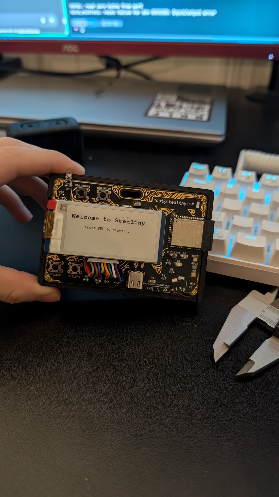
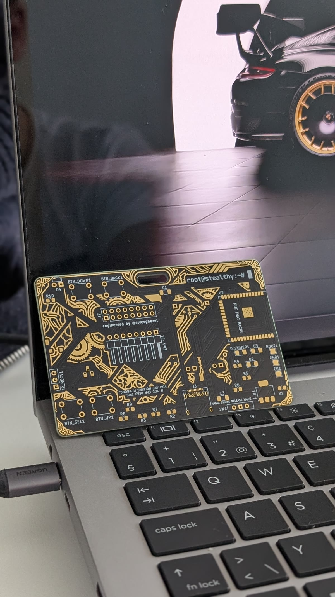

<p align="center">
  
</p>

<h1 align="center">Stealthy</h1>

<p align="center">A pocket security-research badge on the ESP32-S3: custom PCB, 2.13" e-ink screen, four buttons, infrared, WiFi tooling, offline TOTP, and a password-protected captive-portal web UI. Firmware written in C++ from an empty repo.</p>

<p align="center"><a href="https://elyesghazel.ch/projects/stealthy"><b>Read the story</b></a> · <a href="https://github.com/elyesghazel/stealthy-firmware/issues"><b>Issues</b></a></p>

---

I wanted to understand how wireless attacks actually work at the packet level, so instead of buying a tool I built one. The hardware is a board I designed in KiCad; this repo is the firmware that runs on it. Every tool is its own on-device app, with a shared web UI the badge hosts over its own AP. Built for learning and authorised testing on my own equipment.

The full write-up (board, bodge wires, brown-outs and all) is at **[elyesghazel.ch/projects/stealthy](https://elyesghazel.ch/projects/stealthy)**.

## Build and flash

Needs [PlatformIO](https://platformio.org/).

```sh
pio run --target upload       # flash firmware
pio run --target uploadfs     # flash the web UI (LittleFS) - do this on first flash
pio device monitor            # serial monitor, 115200
```

Target board: `4d_systems_esp32s3_gen4_r8n16`, upload at 921600 baud, filesystem is LittleFS.

## What it does

**Badge** - name, tagline, battery, IR count, uptime and a QR code on the e-ink face. Up to three named profiles, switched from the portal.

**IR Tools** - record infrared signals, replay them, save them, browse the library. Reads and writes the Flipper Zero `.ir` format, so captures move between devices.

**WiFi Tools** - deauth a target AP after a scan, or run the beacon-flood + karma combo described below.

**Portal** - a captive-portal AP (`STEALTHY-SETUP` on `192.168.4.1`) with a full web UI for configuration, IR library, probe recon and TOTP. Password-protected; leave blank for open.

**TOTP** - offline 2FA codes rendered on the e-ink display. Time syncs from the browser every time the portal loads, so codes survive reboots without a round-trip.

**Apple Juice** - BLE proximity spam for nearby Apple devices.

## Beacon flood + karma troll portal

Two features that are built to run together. The beacon flood broadcasts fake 802.11 beacons for every SSID in your list (up to 20), so nearby devices see them in their WiFi scanner. Nothing is behind them, so nobody can connect at that stage.

The karma AP sits alongside and listens for probe requests on channel 6. When a device probes for any SSID from the flood list, the AP instantly renames itself to match and sends a spoofed probe response. The device connects, DNS redirects all its traffic to a configurable troll page, and the AP then shape-shifts to catch the next probe.

Configure SSIDs, the initial AP name and the troll HTML in the **Flood** tab of the portal.

## Navigation

Four buttons: **Up**, **Down**, **Select**, **Back**. Auto-repeat on Up/Down kicks in after 100 ms, fires every 40 ms.

| Shortcut | Does |
|----------|------|
| Long **Back** | Main Menu (from anywhere) |
| Long **Back** on Main Menu | Badge display |
| Long **Select** on Main Menu | Toggle portal on/off |
| Long **Select** in IR Tools (Captured) | Save the capture |

## Hardware

| Function | GPIO |
|----------|------|
| Buttons: Up / Down / Select / Back | 10 / 11 / 12 / 13 |
| LEDs: Blue / Green | 2 / 1 |
| IR TX / RX | 14 / 21 |
| Battery ADC | 9 |
| Wake from deep sleep (EXT1) | 12 |

MCU: 4D Systems Gen4 R8N16 (ESP32-S3). Display: 2.13" GxEPD2 e-ink, 250×122, partial refresh. Filesystem: LittleFS. A physical kill switch cuts VCC when it's off. USB-C with the 5.1 kΩ CC resistors modern chargers want.

<p align="center">
  
</p>

## Captive portal

Connect to **STEALTHY-SETUP**, open any URL, get redirected to the dashboard.

| Tab | What you can do |
|-----|----------------|
| System | Battery, autostart, sleep timeout, start screen, portal password |
| Profiles | Up to three badge profiles; set the active one |
| Badge | Name (max 12 chars), tagline, status, QR data |
| IR Library | Send, rename, export or delete captures |
| IR Upload | Upload Flipper `.ir` files, browse signals, send remotely, import |
| Flood | Beacon SSID list, karma config, troll page HTML |
| Recon | Passive probe sniffer + karma AP |
| TOTP | Offline 2FA codes, name + base32 secret |

## Storage layout (LittleFS)

```
/config/     badge name, tagline, status, QR, SSID list, device settings,
             portal password (SHA-256), troll config, TOTP accounts
/ir/saved/   captured signals (0001.ir + 0001.txt pairs)
/ir/uploads/ Flipper Zero .ir files
/web/        portal UI (index.html, app.js, style.css, troll.html)
/payloads/   arbitrary files
```

## Architecture

```
src/framework/  IApp interface + AppManager state machine + AppContext service locator
src/apps/       one file per screen app
src/display/    GxEPD2 wrapper, full + partial page-loop rendering
src/input/      debounce, long-press, auto-repeat, event queue
src/power/      battery ADC, deep sleep, sleep timeout
src/storage/    LittleFS driver + settings / IR / TOTP management
src/ir/         IRremoteESP8266 capture + replay + Flipper parser
src/led/        LED animation state machine
src/portal/     WebServer + DNSServer + REST API + session auth
src/wifi/       WifiSpammer (beacon flood), WifiDeauth, WifiKarma, TrollPortal
src/totp/       HMAC-SHA1 + base32 for RFC 6238 codes
```

Managers are bundled into an `AppContext` and passed to every app; apps never reach for globals. Apps are singletons instantiated once at boot; `AppManager::switchTo()` fires `onExit()` and `onEnter()` on transitions.

E-ink rendering uses a **page-loop** pattern: wrap draws between `startFullWindowDraw()` / `startPartialWindowDraw()` and `while (display.nextPage())`. Prefer partial updates; the full flash costs the most current, and that's what used to brown the board out.

## Adding an app

1. Subclass `IApp`, implement `onEnter`, `onExit`, `handleButton`, `update`, `render`.
2. Access any manager via `_appManager->context()->storage` / `->ir` / `->power` / ...
3. Instantiate at file scope in `main.cpp`, call `setup()` after the other apps, wire it into a parent menu.

See any file in `src/apps/` for a worked example.

## Legal

For learning and authorised testing on hardware and networks I own or have written permission to touch. Beacon flood, deauth and karma frames in particular are illegal to transmit against other people's equipment in most jurisdictions. Don't.
